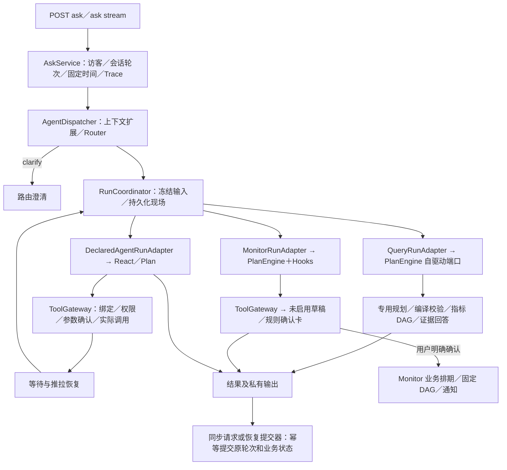

# MarketPilot

MarketPilot 是面向加密货币行情查询的 AI Copilot。用户用自然语言描述查询对象、时间和计算需求；Planner 生成指标逻辑计划，Java 编译并执行有界 DAG，回答模型根据本轮事实组织答案。取数、时间消解、完整性检查和数值计算由代码完成。

项目仓库：[wztbbs/MarketPilot](https://github.com/wztbbs/MarketPilot)。

本文及 `docs/` 的现行专题描述当前工作树；`docs/archive/` 与各验证记录保留历史状态。`importants/` 保存文章、设计过程和实验产物；其中的历史计划、能力表和示例不作为当前接口契约。

项目更名后，现有 Java 包名 `com.cexpilot`、Maven artifactId `cexpilot`、数据库名、环境变量和 Cookie 等技术标识继续沿用，文档中的命令及源码链接与当前实现保持一致。线上地址仍为 [cex.hrscrm.net](https://cex.hrscrm.net/)。

## 文档入口

从 [文档导航](docs/README.md) 进入。文档已按底座与 CEX 业务归类，过时设计单独归档。

| 入口 | 内容 |
| --- | --- |
| [当前架构](docs/当前架构.md) | 单体内的包边界、持久化运行、两类业务 Agent 与状态归属 |
| [底座文档](docs/platform/README.md) | Agent 接入、引擎、工具控制、人工确认和等待恢复 |
| [CEX 业务文档](docs/cex/README.md) | Query、Monitor、行情、页面、排查与测试 |
| [CEX 领域知识学习](domain/README.md) | 产品、价格时间、衍生品、盘口、分析、监控与跨所口径 |
| [历史设计](docs/archive/README.md) | 早期 Harness 和已停用协议；不作为当前契约 |

底座故障验证与 CEX 迁移测试分别保存在各自目录，阅读记录时核对日期、被测对象和覆盖范围。

## 共享底座与 Agent

当前在同一 Spring Boot 服务中运行共享 Harness：AgentRegistry 注册内置 Market Analysis、Monitor，以及采用受控 YAML 定义的普通 Agent。底座共用 LLM、Context、Evidence、Trace、预算与工具契约；Query 走指标 DAG 和有界反馈，Monitor 保留确认与长期任务，声明式 Agent 经统一入口执行白名单工具，支持确定参数确认，以及 ReAct / Plan 的持久化等待、异步查单和恢复。Monitor／Query 对话运行也已通过业务适配器接入持久化 Run；Query 保留自驱动规划，Monitor 后台排期与通知仍归业务。整体图与职责见 [当前架构](docs/当前架构.md)。

普通 Agent 的标准接入可只增加 YAML、Prompt、Schema 和远程服务，不新增专用 Java Tool 类；新增指标或执行生命周期仍需相应实现。示例位于 `examples/http-agent/`，默认不加载，不代表已提供新的线上行情或洞察能力。

查询后的监控追问可显式交接条件摘要，并保留源查询版本；Monitor 仍生成原待确认卡片。Query 后续规划、声明式 HTTP Agent 和显式交接支持按访客稳定灰度与配置回退，详见[交接、灰度与验收](docs/cex/交接灰度与验收.md)。

## 当前支持范围

行情主流程已接入 Binance / OKX 的 **USDT 报价现货和 USDT 报价、USDT 结算永续合约**，具体指标按市场绑定区分。交割合约、币本位或其他报价币不会自动改写为支持的产品。

能力以 [指标目录](src/main/resources/metrics/cex-perpetual.yml) 的 `metric + query_shape + exchange` 绑定为准；底层 Service 或 Tool 存在不等于 Planner 可以调用。

| 指标族 | 已接入形态 | 关键限制 |
| --- | --- | --- |
| 成交价格 `price.*` | 最新价快照、官方 24h 涨跌幅、K 线区间 OHLC / 涨跌幅及 OHLC 序列 | 成交 K 线支持 5m / 15m / 1h；区间收盘价不是实时价 |
| 成交量 / 成交额 `trade.*` | 区间成交量 / 真实成交额、成交量序列、官方 24h 数据 | 官方 24h 成交额仅 Binance；OKX 区间真实成交额可查 |
| 持仓量 `oi.*` | 当前基础币数量、数量序列、期初 / 期末 / 变化量 / 变化率 / 极值 | 历史缺省 1h；Binance 历史保留期按代码限制为最近 30 天 |
| 标记价 / 指数价 `mark.*` / `index.*` | 当前快照、区间 OHLC / 涨跌幅及 OHLC 序列 | 5m / 15m / 1h；不提供成交量、成交额 |
| 盘口 `orderbook.*` | 买一、卖一、价差、不平衡度快照 | depth 默认 20，范围 5～50；不平衡度为最多 10 档买量 / 卖量 |
| 主动买卖 `taker.*` | 区间买量、卖量、买量占比 | 当前仅 Binance，固定官方 5m 统计，不接受自选粒度 |
| 已结算费率 `funding.rate_settled` | 最近 N 期样本 | N 必填，1～100；未接入时间窗口、预测费率和下次结算时间 |

计算支持 `avg / sum / min / max / compare / difference / ratio / relative_change / annualize`，也支持用户明确给出的常量。Ethereum 分析代码及 Tool 仍在仓库中，但不在当前指标 Planner 的可规划能力内。

可查询示例：

- “分别列出币安和 OKX 的 BTC 最新成交价。”
- “昨天币安 BTC 永续成交额比 OKX 高百分之多少？”
- “币安 BTC 昨天 1 小时 K 线收盘价的等权平均是多少？”
- “币安 BTC 最近 10 期已结算资金费率的均值是多少？”

Query 默认走单次 DAG；当首轮模型选择 `execution_mode=adaptive` 时，可根据执行结果有界追加查询或计算。已有节点复用，不重复取数；全部执行结束后统一回答。协议、预算与验证边界见 [查询执行反馈](docs/cex/query/查询执行反馈.md)。

## 一次问答如何执行



正常查询通常依次调用 Router、Query Planner、Answer。Monitor 分支通常调用 Router 和独立 Monitor Planner，将候选保存为待确认草稿并展示规则，用户核对规则和通知邮箱、点击确认后才启用后台检查。规划校验失败会增加修复调用；没有有效查询计划时不调用 Answer。模型通过 JSON 文本生成计划，各阶段均不传 API `tools` 参数。原查询 LogicalPlan 协议不变，路由与监控规划协议见上方专题文档。

指标事实统一包含身份、单位和来源；时间查询还包含覆盖状态。区间不完整时 Provider 可返回 `statistics_omitted` 而不返回 `value`，因此 `ok=true` 只表示执行成功。依赖失败或不完整数据的计算不会补算；独立分支可以继续返回结果。Answer 的提示词要求只引用已有指标和算子结果，不能自行补出差值、均值、年化等结论。

## 本地启动

先克隆仓库并进入项目目录：

```bash
git clone git@github.com:wztbbs/MarketPilot.git
cd MarketPilot
```

依赖：JDK 17、Maven、MySQL 8，以及可用的 OpenAI 兼容模型服务。版本和依赖见 [pom.xml](pom.xml)，配置见 [application.yml](src/main/resources/application.yml)。公共行情查询不需要交易所账户 Key。

以下命令从仓库根目录执行，使用 `test` profile：

```bash
mysql -u root -p -e 'CREATE DATABASE IF NOT EXISTS cexpilot_test DEFAULT CHARSET utf8mb4'

export DB_HOST=127.0.0.1
export DB_PORT=3306
export DB_NAME=cexpilot_test
export DB_USER=root
export DB_PASSWORD='<本地数据库密码>'
export LLM_NORMAL_API_KEY='<模型服务密钥>'
export LLM_NORMAL_BASE_URL='https://dashscope.aliyuncs.com/compatible-mode/v1'
export LLM_NORMAL_MODEL='qwen-plus'
export SERVER_PORT=8082

mvn spring-boot:run -Dspring-boot.run.profiles=test
```

访问 [本地问答页](http://localhost:8082/)；Trace 页为 `http://localhost:8082/trace.html?id=<traceId>`。

当前本地和服务器环境使用以下交易所代理，基础配置已将其设为默认值：

```yaml
exchange:
  binance:
    base-url: http://43.160.213.63:18080
  okx:
    base-url: http://43.160.213.63:18081
```

其他部署环境可以通过以下环境变量覆盖为符合仓库约定的可访问代理地址。监控业务不校验固定代理地址，连接异常在实际取数时报告。`application-test.yml` 固定上述代理地址，不使用这两个环境变量占位符：

```bash
export BINANCE_BASE_URL='http://43.160.213.63:18080'
export OKX_BASE_URL='http://43.160.213.63:18081'
```

OKX 请求必须携带 `User-Agent`，否则可能收到 `403 error code: 1010`。当前 OkxClient 已统一设置该请求头。历史游标方向与分页细节见 [时间窗口](docs/cex/market/时间窗口.md)。

新库启动时自动执行 [schema.sql](src/main/resources/db/schema.sql) 建表。**存量库不会自动升级字段**：`CREATE TABLE IF NOT EXISTS` 不执行 ALTER，也没有自动迁移框架；部署前需核对 [migrations](src/main/resources/db/migrations) 并手工执行尚未应用的迁移，不能把所有 ALTER 重复执行。

当前 Query 任务模型使用 conversation_task／conversation_task_version，旧 frame 模型已由 [022_unified_task_model.sql](src/main/resources/db/migrations/022_unified_task_model.sql) 替换。旧任务不迁移兼容；旧库需按已应用版本及脚本前提停服、备份、升级，不能只执行早期 013 后启动当前代码。完整结构关系见[数据库说明](src/main/resources/db/README.md)。

通用运行的 platform_run／platform_tool_call／platform_run_checkpoint 已在 schema.sql 中，当前没有独立编号迁移文件；启动初始化会创建缺失表，需确认对应权限和配置。已有表结构发生变化时仍需显式升级，不能依赖 CREATE TABLE IF NOT EXISTS。

构建及运行 JAR：

```bash
mvn clean package -DskipTests
java -jar target/cexpilot-0.1.0.jar --spring.profiles.active=test
```

`prod` 使用 [application-prod.yml](src/main/resources/application-prod.yml) 的线上数据库配置，密码来自 `MYSQL_PASSWORD`；不要将本地 `DB_*` 变量误认为可以替换该 profile 的固定数据库地址。

主动监控仅保留聊天确认入口 `/api/monitor-flow`，运维巡检为 `/api/monitor-health`。沿用已有数据库和模型配置时，模拟邮件部署只需新增 `MONITOR_ENABLED=true`、`RESEND_DRY_RUN=true`，以及巡检所需的 `MONITOR_ACCESS_TOKEN`（至少32字符）。收件邮箱由用户填写并确认，调度随应用启动，不需要额外cron。014～019 是监控业务结构的演进记录；部署当前应用还需核对后续任务模型及底座运行表，见[完整数据库说明](src/main/resources/db/README.md)。

## 常用运行配置

| 配置 / 环境变量 | 当前默认值 | 用途 |
| --- | --- | --- |
| `server.port` / `SERVER_PORT` | 8082 | HTTP 端口 |
| `llm.normal.model` / `LLM_NORMAL_MODEL` | qwen-plus | 首次 Planner 与 Answer 使用模型 1 |
| `llm.flagship.model` / `LLM_FLAGSHIP_MODEL` | qwen-max | Planner 校验失败后，修复调用使用模型 2 |
| `LLM_FLAGSHIP_BASE_URL` / `LLM_FLAGSHIP_API_KEY` | 沿用 normal 的地址 / Key | 可独立覆盖以接入不同服务商 |
| `LLM_NORMAL_ENABLE_THINKING` | false | 模型思考开关 |
| `LLM_TEMPERATURE` / `LLM_SEED` | 0 / 不下发 | 采样参数 |
| `DAG_MAX_NODES` | 8 | 展开后的执行节点上限，还受 `llm.max-tool-calls=8` 限制 |
| `DAG_MAX_DEPTH` | 3 | 依赖深度上限 |
| `DAG_EXECUTOR_THREADS` | 4 | DAG 固定线程池大小 |
| `DAG_NODE_TIMEOUT_MS` | 30000 | 回收单节点 Future 的等待预算，不保证终止底层 HTTP |
| `DAG_PLANNER_MAX_RETRIES` | 2 | 含首次最多 3 次：模型 1 → 模型 2 → 模型 2；绑定失败仍最多修复一次 |
| `DAG_PLANNER_RESPONSE_FORMAT` | 空 | 不下发结构化约束；可选 json_object / json_schema，需模型支持 |
| `LLM_NORMAL_PRICE_INPUT_PER_1K` / `LLM_NORMAL_PRICE_OUTPUT_PER_1K` | 0 / 0 | 模型 1 成本估算单价 |
| `LLM_FLAGSHIP_PRICE_INPUT_PER_1K` / `LLM_FLAGSHIP_PRICE_OUTPUT_PER_1K` | 0 / 0 | 模型 2 成本估算单价，独立于模型 1 |

同一服务商时，设置 `LLM_FLAGSHIP_MODEL` 即可选择模型 2；地址和 Key 没有单独设置时继承 normal。LLM_FLAGSHIP_MODEL 未设置时默认 qwen-max；normal 默认值见上表。不同服务商时同时设置第二套地址和 Key；两套模型都需支持当前配置的 JSON 输出格式。

只在规划解析/编译/校验实际进入修复循环时切换，正常澄清、出域、能力说明和 HTTP 超时/鉴权错误不会触发这个切换。Answer 始终使用 normal。每次 LLM_CALL 记录实际模型；总费用按各次调用对应模型单价汇总，缺失 usage 时为未知。两套默认单价为 0，不表示实际免费。

配置和提示词随进程加载，不支持热更新；环境变量更改后重启生效，代码或提示词更改后重新构建并重启。

Trace 单条接口保留完整 `events`，另提供 `planner_attempts`、`final_plan`、`final_compiled_plan`。每次尝试直接记录模型、调用状态、校验状态和失败原因；批量 `/api/traces` 也保留轻量 `planner_attempts`，便于比较模型 1 首次失败与模型 2 修复成功。页面只展示最终可执行 Plan；详情约定见 [上下文管理](docs/cex/query/上下文管理.md)。

## HTTP 接口

以下请求会真实调用服务，仅作为手工调用示例。

```bash
curl -sS 'http://localhost:8082/api/ask' \
  -H 'Content-Type: application/json' \
  -d '{"question":"昨天币安 BTC 永续成交额是多少？","timezone":"Asia/Shanghai"}'

curl -N 'http://localhost:8082/api/ask/stream' \
  -H 'Content-Type: application/json' \
  -d '{"question":"分别列出币安和 OKX 的 BTC 最新成交价。","timezone":"Asia/Shanghai"}'
```

| 方法与路径 | 输入与输出 |
| --- | --- |
| `POST /api/ask` | 基本输入 `question`、可选 IANA `timezone`；返回 answer、evidence、traceId、conversationId、turnId、耗时与计数等，见 [AskResponse](src/main/java/com/cexpilot/business/cex/api/AskResponse.java) |
| `POST /api/ask/stream` | 同类请求，SSE 事件为 meta、progress、delta、done、error；done 提供标识与统计，答案由 delta 累积 |
| `GET /api/trace/{traceId}` | 返回主记录与按 seq 排序的完整事件 |
| `GET /api/trace_detail/{traceId}` | 当前与单条 trace 接口读取相同完整数据，保留兼容路径 |
| `GET /api/traces?beginHour=4&endHour=0` | 批量查询最近 4 小时；beginHour > endHour ≥ 0，窗口最长 24 小时，内联事件省略输入输出重字段 |
| `POST /api/feedback` | `{traceId, rating, category?, comment?}`，rating 取 up/down |

SSE 发起后即返回流，执行异常通过 `error` 事件传递，不能仅凭 HTTP 200 判断成功。前端入口为 [index.html](src/main/resources/static/index.html)，回放入口为 [trace.html](src/main/resources/static/trace.html)。

线上入口：[cex.hrscrm.net](https://cex.hrscrm.net/)。定位问题先看 Trace 中的逻辑计划、绑定、取数与计算，再看最终答案，详见 [Trace搭建](docs/cex/operations/trace搭建.md)。

## 代码导航与开发检查

| 目录 | 职责 |
| --- | --- |
| `platform/agent`、`platform/context` | 公共 Agent、路由／分发与上下文扩展端口 |
| `platform/engine` | 通用 ReAct、Plan、DAG 执行 |
| `platform/run`、`platform/tool` | 持久化运行、恢复、工具契约、控制与通用计算 |
| `platform/execution`、`llm`、`prompt`、`observability` | 执行结果／预算、模型与提示词、Trace 端口；所列目录均在 platform 下 |
| `business/cex/query`、`monitor` | 专用查询状态机与运行适配；监控规则、周期执行和通知 |
| `business/cex/metric`、`market`、`time` | 指标编译／Provider、行情查询与交易所、时间语义 |
| `business/cex/conversation`、`evidence`、`context`、`handoff` | 业务任务／版本、事实、上下文与条件交接 |
| `business/cex/api`、`trace`、`feedback` | 站点入口、Trace 存储／回放与反馈；所列目录均在 business/cex 下 |
| `business/cex/ethereum`、`eval`、`mcp` | 既有链上分析、文件评测、行情 MCP 适配与 Server |
| `bootstrap/configuration` | 基础设施装配 |

按变更选择直接相关测试，先编译测试代码，再跑指定测试：

```bash
mvn test-compile
mvn test -Dtest=MetricCatalogTest,MetricPlanCompilerRegressionTest,PlanValidatorTest
```

各专题列出对应测试入口。全量 `mvn test` 仅在明确要求或 CI 场景执行。`scripts/` 下探针和回归会调用线上服务，只在明确收到执行指令时运行；运行前备份上一轮报告及原始 JSON，结束后逐条比较 verdict，并独立复核 FAIL → PASS 的数值。约束见 [AGENTS.md](AGENTS.md)。
