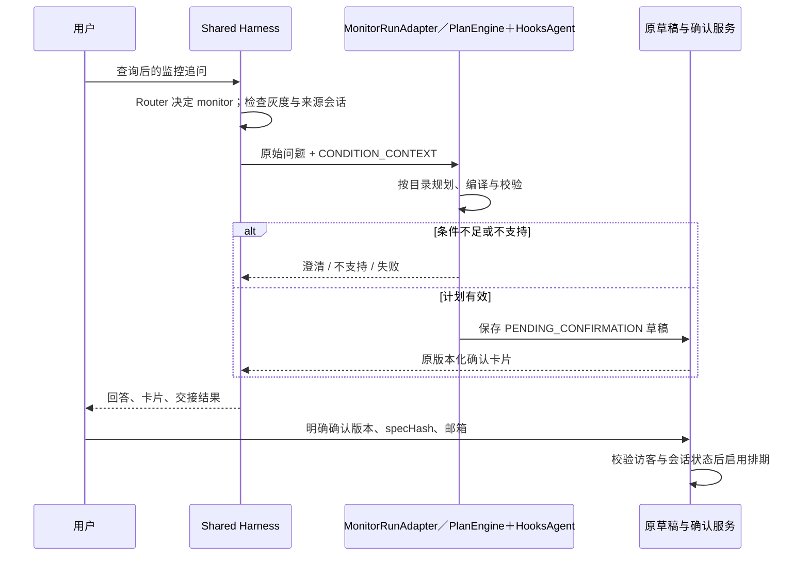

# CEX 条件交接、灰度与验收

本页说明当前 Query → Monitor 条件交接及按访客灰度配置。Query／Monitor 对话均已接入持久化 Run，运行恢复协议见[业务运行适配](Monitor与Query运行迁移.md)。灰度控制功能准入，工具授权与规则确认仍单独检查；开发完成与线上验收分别记录。

## 交接的触发和来源

此前 Router 已能把查询追问转到 Monitor，Monitor 也能读取 query_task 理解指代，但缺少结构化来源与交接结果。现在仍由 Router 判断本轮用户是否要监控，Dispatcher 在调用原 MonitorAgent 前建立条件摘要，不增加第二次 Router、不先执行 Query，也不构造新的 Agent 循环。

实现位于 `AnalysisMonitorHandoff`。仅当 Router 选择 monitor、当前 active_agent 为 query、存在同会话当前 TaskVersion 且其 QueryDefinition 非空、且本轮 handoff 灰度开启时建立交接。访客与源会话的归属继续由原 API / ConversationService 校验；额外检查当前 TaskVersion 与 EvidenceSession 的 conversationId 一致，错会话时记录拒绝并停止执行。

`context.handoff` 包含协议版本、source_agent / target_agent、源 taskId / version / turnId / request_time、源状态、`context_kind=CONDITION_CONTEXT`、`requires_confirmation=true`，以及逐目标的 metric / exchange / instrument / query_shape / unit。最多投影 8 个目标，同时给出 target_count 与 targets_truncated，不能据截断列表默认选第一个。

交接摘要不包含历史结果值、计算结果、样本、Evidence 引用、固定日期或执行元数据。交接时移除接收方的 query_task，避免把原 Query 的完整语义状态当成监控计划；近期对话及既有 monitor_context 仍保留，作为待理解的数据。用户本轮明确修改优先，已有 ACTIVE 规则的限制也保持生效。

Monitor Prompt 说明：多个目标有歧义要追问；历史数值不能自动变成阈值；没有明确窗口或比较条件不能凭交接生成规则。这些语义由模型判断，不能声称 Prompt 能证明模型永不漏判。程序仍对实际计划执行原目录、市场、滚动窗口、单所单品种、引用及阈值结构校验，再保存原确认卡片；用户最终核对并确认。

交接本身不授权创建或启用后台任务。Monitor 可以返回 NEEDS_CLARIFICATION / UNSUPPORTED / FAILED；有效计划通过 ToolGateway 的 monitor.rule.create_draft 调用 MonitorConversationFlow，只保存待确认草稿。确认继续要求原访客、当前版本、specHash、绑定邮箱、会话轮次释放、执行能力可用；没有模型自动确认入口。

## 结果与失败追踪

- `AGENT_HANDOFF / PREPARED`：接收方执行前，记录条件来源。
- `AGENT_HANDOFF / DELIVERED_TO_MONITOR`：Monitor 返回，outcome 保留 PENDING_CONFIRMATION、NEEDS_CLARIFICATION、UNSUPPORTED 或 FAILED 等实际状态；DELIVERED 不代表启用或业务成功。
- `AGENT_HANDOFF / MONITOR_EXECUTION_FAILED`：Monitor 抛异常，保留原异常和用量处理；检查该轮错误与持久化草稿状态，不能假定所有失败都未落草稿。
- `AGENT_HANDOFF / REJECTED`：来源会话不匹配，不执行 Monitor。

正常返回的 `agentPayload.handoff` 随现有 conversation_query.agent_payload_json 保存，API / SSE 和历史接口可读取；Trace 同时保留交接起止。原卡片和业务载荷保持原形状，只增加 handoff 字段。不新增表或迁移。

Monitor 会话状态同时保留 monitor_context.handoff，使“先追问阈值/窗口 → 用户补充 → 生成草稿”的后续轮次可读取条件来源。它是历史来源，不代表后续新话题都沿用该来源；用户新条件优先。状态写入仍受原 fencing token 保护，不修改 QueryDefinition。

本期仅实现跨轮 Market Analysis → Monitor 的条件交接；Monitor → Query 沿用原路由与查询逻辑。普通 HTTP Agent 不把结果自动转为指标或监控条件；没有任意 Agent 间自动交接，也没有洞察链路。

### 与异步 Run 结果的关系

PREPARED 摘要在分发前写入上下文，随后冻结到 Run 输入。Dispatcher 的 DELIVERED_TO_MONITOR 记录的是当次分发返回，可能只是 WAITING，不代表后台运行或规则启用已经完成。outcome 不存在时也可能显示 UNKNOWN；实际状态应查 runId 及最终业务结果。

恢复从 RunCoordinator 进入适配器，不会再次执行 Dispatcher 的交接收尾。不能依赖恢复结果必然附带一份重新生成的 handoff/outcome；应关联初始 Trace、持久化输入和监控上下文中的来源。历史交接来源不是对后续新条件的授权。

## 灰度配置

实现位于 `HarnessRolloutConfig`。配置在启动时校验，修改后需要重新启动；没有远程配置接口或热更新。默认 100 开放这些特性；该默认值不表示已经部署或在线验收。

| 环境变量 | 默认 | 设为 0 的行为 |
| --- | --- | --- |
| HARNESS_ADAPTIVE_QUERY_PERCENT | 100 | 本轮不进入 Query 后续规划；初次 DAG 与答案仍执行，未完成任务保留 ADAPTIVE_DISABLED / PARTIAL 状态 |
| HARNESS_HTTP_AGENTS_PERCENT | 100 | 对当前访客隐藏声明式 HTTP Agent 路由，并在执行前再次检查；内置 query / monitor 仍可路由 |
| HARNESS_HANDOFF_PERCENT | 100 | 关闭新增的显式条件摘要与交接记录，回到既有 query_task 上下文投影；不关闭 Monitor 或正常创建监控的能力 |
| HARNESS_COHORT_SALT | harness-v1 | 分组版本标识；修改会重新分组，格式为 1～64 位字母、数字、下划线或连字符 |

百分比必须是 0～100 的整数。使用可信访客 Cookie 标识与 salt 的 SHA-256 结果稳定分配 10000 个桶；同一访客不会随轮次随机切换，扩大百分比保留原入组访客。三个特性使用同一桶、独立阈值，便于按同一批访客逐步开放。分组不是权限机制；不能用模型、问题文本或前端请求参数决定身份、白名单或服务地址。缺少有效访客时不进入部分比例灰度，100 / 0 仍分别表示全开 / 全关；HTTP 工具和监控草稿仍执行各自身份校验。

`QUERY_ADAPTIVE_ENABLED=false` 优先于灰度。请求级配置从全局预算复制，只能收紧，不能重置 Router 已用调用、扩展父预算或重新打开已关闭的 adaptive。灰度关闭不会取消已在远端接收的请求，也不会影响已启用监控的后台执行。

Router 只收到当轮开放的注册定义；模型坚持选择隐藏路由时按原修复/澄清流程处理，不调用该 Agent。实际 HTTP Agent 执行失败时不自动改走另一条查询路径掩盖故障。即使灰度为 0，启动时仍校验配置；坏 YAML 应修复或设置该 Agent 的 enabled=false。

`HARNESS_ROLLOUT` Trace 事件记录当轮 adaptive_query / http_agents / handoff 决策及 policy_version，不记录访客或其散列。adaptive_query 是公共预算中的实际开关；单次查询本来就不需要后续规划时不会因此增加调用。总 Prompt 指纹包含灰度策略与交接协议版本。

## 验收与上线步骤

本地验收使用脚本模型、真实目录和校验器、H2 事务及 localhost HTTP 桩；不能据此推断真实模型的长尾规划质量或线上 API 的可靠性。原文件 E2～E4 涉及洞察/套利的场景已从执行范围删除，改用 Query 有界补查测试验证模型观察后的分支选择。

| 范围 | 本地检查 |
| --- | --- |
| 原 Query、时间与计算 | 真实编译和 DAG；两所均值比较、确定性算子、根据中间结果选择后续分支、预算与重复检测 |
| HTTP / YAML 扩展 | 声明式 Agent 到路由、HTTP 工具、证据保存与回答；非法地址、越权、Schema、时效、超时及失败状态 |
| 分析转监控 | 保留源版本与现货市场；缺条件澄清；跨所候选被拒绝；有效候选只落待确认草稿 |
| 监控确认与生命周期 | 未绑邮箱、错误 specHash、其他访客均不能确认；明确确认后启用；原排期、恢复与通知定向测试 |
| 灰度与回退 | 稳定分组、扩大比例、关闭路由后模型无法绕过、关闭后续规划、全局开关优先、请求预算与状态隔离 |

2026-11-07 本地验证：先执行 `mvn test-compile`，再执行 27 个直接相关测试类，共 431 项通过，失败、错误、跳过均为 0；`git diff --check` 通过。包含 H2 中“交接 → 澄清 → 状态与历史持久化 → 下一轮生成草稿”的接续检查，以及错误访客/错误摘要/未绑邮箱无法确认、异常仍保留用量的检查。没有运行全量单测、线上回归、收费模型重放、真实交易所请求或邮件投递，未部署。

部署时先使用干净构建，避免旧编译产物混入。交接／灰度字段本身不额外建表，当前完整应用仍须核对[数据库迁移清单](../../src/main/resources/db/README.md)，包含任务版本和通用运行表。可先将三个百分比设为 0，完成原 Query / Monitor 冒烟，再按 10 → 50 → 100 逐步开放；每步使用相同 salt，观察 Trace 的首轮规划、修复/继续次数、工具与 HTTP 次数、失败原因、缓存命中与交付时延，同时逐条检查答案来源和监控确认内容。百分比是可配置发布流程，本次没有操作线上部署。

回退时将对应百分比降为 0 并重启；Query 可同时设置 QUERY_ADAPTIVE_ENABLED=false，单个声明式 Agent 可设置 enabled=false。已有监控仍按原固定 DAG 执行，停止它们应走原监控操作，不应借架构回退删除规则。二进制整体回退需使用已知版本并重新做部署验收，不能把关闭开关等同于旧二进制完全兼容。

线上 common 回归、收费模型重放、监控冒烟及真实发信只在用户明确要求相应测试时执行，仍遵循 AGENTS.md 的备份、逐条对比和真实邮件约束。当前代码交付不包含线上验收。
