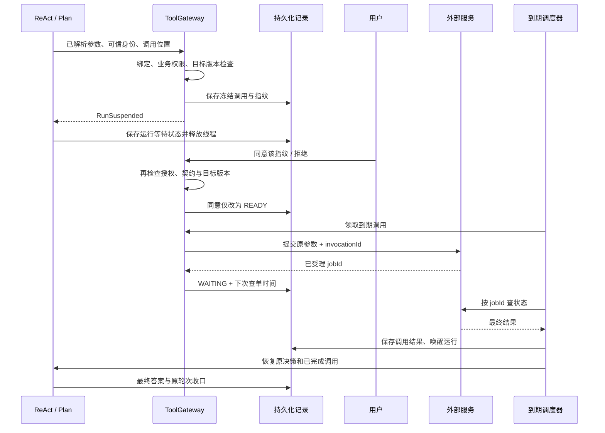

# 工具控制与可恢复运行

底座在单个 Spring Boot 工程内提供工具执行控制、确定调用的确认，以及声明式和已适配业务 Agent 的持久化等待和恢复。业务运行接入已通过 AgentRunAdapter 解耦，接入方法与真实 MySQL／JVM 重启验证见[业务 Agent 持久化运行接入](业务Agent持久化运行接入.md)。仍然保持 `business → platform` 的依赖方向，不拆独立服务，不引入完整 ABAC、账户／租户授权系统或跨工具事务。

## 对象与职责

| 对象 | 含义 | 保存内容 |
| --- | --- | --- |
| ToolDefinition / ToolControl | 一种工具及其执行语义 | 输入输出契约、READ/OPERATION、确认要求、可信摘要、资源版本参数位置、幂等声明、等待有效期 |
| ToolContext | 服务端确定的调用身份 | 访客、代办 Agent、工具绑定、会话、Trace、固定请求时间、invocationId |
| ToolGateway | 所有引擎的工具执行入口 | 检查绑定和业务策略，冻结参数，检查确认，提交或查询实际执行 |
| ToolAccessPolicy | 应用的授权扩展 | 用户／数据权限检查；初次提案、确认和实际提交均调用 |
| ToolResourceGuard | 应用的目标版本检查 | 读真实资源版本，与被冻结的版本比较 |
| ToolCall | 一次已经确定的调用 | 规范化参数、目标版本、契约与内容指纹、确认人／决定、外部 jobId、执行结果 |
| Run | 一个引擎的持久化运行 | runId、原输入与时间、Agent／协议版本、决策检查点、累计预算和最终结果 |

`runId` 是运行身份，`invocationId` 是本次运行中一个调用的稳定身份；二者都不是 conversationId、turnId、查询 taskId 或 TaskVersion。确认通过表示允许执行这份调用；只有真实执行结果才表示操作完成。

当前默认策略检查当前注册的 Agent–Tool 绑定；Query／Monitor 均通过 ToolBoundAgent 显式提供绑定。已有访客 Cookie 继续作为站点身份来源，没有把它升级成账户认证。真实数据权限由应用提供 `ToolAccessPolicy`，以及下游服务依据可信身份检查；工具类别和用户确认均不能代替数据权限。没有操作工具绑定的路径不获得操作授权。Monitor 仅显式绑定自身草稿操作及计算工具，启用规则仍由业务确认。

## 工具请求与状态推进

ToolGateway 保留两个不同调用方的入口：

| 方法 | 调用方与职责 |
| --- | --- |
| invoke(name, arguments, context, position) | 引擎经 ToolRegistry.invoke 进入；校验并登记／复用调用，返回结果或抛 RunSuspended |
| process(id) | 首次 READY 请求或 RunReconciler 调用；领取记录、检查可执行条件，实际提交／轮询／查单并保存状态 |

invoke 内部按顺序执行 normalizeArguments、授权检查、findOrCreateCall、必要时 process、readResultOrSuspend。无 RunScope 的同步只读调用由 executeReadWithoutRun 处理；操作和异步工具仍被拒绝。

process 按以下步骤组织；任一步发现无需继续或已失去执行权，都提前返回：

| 步骤 | 方法 | 职责 |
| --- | --- | --- |
| 领取执行权 | claimCall | 领取租约与 fencing token，跳过已结束调用 |
| 校验并准备 | prepareExecution | 处理过期、待确认和所属运行状态，再检查冻结契约、授权及目标版本，恢复工具和调用身份 |
| 标记执行中 | markExecuting | 在外部调用前持久化 EXECUTING，确认未被其他执行者接管 |
| 实际执行 | executeToolCall | 首次提交、轮询外部任务或查单恢复 |
| 保存结果 | saveExecutionOutcome | 保存终态或 jobId、下一次查询时间，完成时唤醒 Run |

executeToolCall 以领取时保留的 `previous` 为主轴，通过 switch 选择本轮动作；调用前数据库状态已由 markExecuting 改为 EXECUTING。

| previous | 方法 | 异步工具 | 同步工具 |
| --- | --- | --- | --- |
| READY | submitCall | 首次 submit | 首次 execute |
| WAITING | pollCall | 必须有有效 jobId，按 jobId poll | 状态不一致，拒绝执行 |
| UNKNOWN／遗留 EXECUTING | recoverCall | 有 jobId 就 poll，否则按 invocationId recover | 工具幂等且所属运行未结束时重试，否则保持 UNKNOWN |

同步提交共用 executeSyncTool，操作结果是否确定由 isUncertainOperationResult 判断。WAITING 的工具类型和 jobId 在进入外部调用阶段前校验；READY 已有 jobId 也视为记录不一致。这些损坏记录保存 FAILED／EXECUTION_ERROR 并记录原因，不回退成首次提交。

异常分别由 retryUnsubmittedCall、handleInvalidCall、handleExecutionFailure 处理，保留未提交重试、授权／契约拒绝、提交前系统失败与外部结果不确定的区别。系统异常在处理边界记录完整异常链，具体规则见[异常处理约定](异常处理约定.md)。审批接口 confirm 只记录决定，工具完成后才唤醒 Run 继续推进。

```text
ReactEngine／DagExecutor → ToolRegistry.invoke → ToolGateway.invoke
  → READY：process → executeToolCall → saveExecutionOutcome
  → readResultOrSuspend：返回结果，或暂停 Agent

RunReconciler → ToolGateway.process：处理工具调用
RunReconciler → RunCoordinator.drive：恢复 Agent 执行
```

这次方法拆分不改变调用 ID、冻结参数、状态机、确认指纹或工具业务接口。

## 工具声明

既有只读工具默认采用 READ 控制语义。操作必须显式声明，示例：

```yaml
name: document.publish
enabled: true
description: 发布指定版本的文档
transport: http
service_id: documents
method: POST
path: /publish
side_effect: true
max_attempts: 1
control:
  kind: OPERATION
  confirmation_required: true
  summary: 发布指定版本的文档
  resource_versions: [/version]
  idempotent: true
  expires_after_seconds: 3600
input_schema:
  type: object
  additionalProperties: false
  required: [document_id, version]
  properties:
    document_id: {type: string}
    version: {type: integer}
output_schema:
  type: object
  additionalProperties: false
  required: [published]
  properties:
    published: {type: boolean}
```

示例没有自动注册。业务接入还需要配置可信服务、服务端权限策略和资源版本检查器。业务 Agent 使用 ToolBoundAgent 声明工具绑定，与声明式 Agent 执行同一绑定校验。`resource_versions` 是参数内的 JSON Pointer；声明后如果没有唯一匹配的 `ToolResourceGuard`，调用会被拒绝。执行器／下游还必须对版本做 CAS 或 If-Match，防止检查与提交之间的竞争。

摘要来自可信定义，页面同时展示完整确定参数和目标版本。内容指纹绑定规范化参数、主体、Agent、会话、工具契约、摘要、目标版本和有效期。浏览器确认仅提交指纹及同意／拒绝，不能替换参数或 Agent。控制配置改变也会改变契约版本，旧提案不能继续执行。

HTTP 操作只允许 POST、单次提交，使用 `Idempotency-Key: <invocationId>`。READ HTTP 仍要求 `side_effect: false`，保留已有信封、输出校验、证据时效、固定地址和凭证隔离。`idempotent: true` 是服务实现必须兑现的承诺，增加请求头本身不能证明上游具有去重能力。

Java 异步工具实现 `AsyncAgentTool`：

```java
ToolExecution submit(JsonNode args, ToolContext context);
ToolExecution poll(String jobId, ToolContext context);
ToolExecution recover(JsonNode args, ToolContext context);
```

submit/poll/recover 都是短调用。长任务返回 `ToolExecution.accepted(jobId, pollAfterMs)`，不占用线程等待一小时；完成后返回 `completed(ToolResult)`。submit 使用稳定 invocationId 关联或去重，recover 用同一 ID 查单，处理“外部已受理、进程尚未保存 jobId”这个窗口。没有可靠查单／幂等协议的业务不能声称实现了外部 exactly-once。

当前声明式 HTTP 适配器承载同步信封；异步任务通过 Java `AsyncAgentTool` 适配外部协议。未实现任意 HTTP 202 / 轮询 URL 的自动推断。

## 方案审批

除默认逐调用确认外，服务端适配器可选择 PREPARED_PLAN，先冻结一份确定的工具调用方案，再一次确认并执行。操作必须经 invokePrepared，实际执行仍检查工具绑定、数据权限、资源版本与获批内容。完整契约见[方案审批与分阶段执行](方案审批与分阶段执行.md)。

## 确认与运行链路



调用状态：`CONFIRMATION_REQUIRED → READY → EXECUTING → WAITING / UNKNOWN → SUCCEEDED / FAILED`，以及拒绝 `REJECTED`、等待过期 `EXPIRED`。模型不会收到“等待”伪装成的工具失败，因此不会以修复参数的方式绕过确认。

运行状态：`READY → RUNNING → WAITING → RUNNING → SUCCEEDED / FAILED`。ReAct 在当前调用结果就绪后，将其作为原 observation 继续决策；声明式 Plan 保留原计划与每个节点的调用结果，不重新提交已经完成的节点。同层独立节点可能分别提交或分别等待确认；整个计划没有跨节点事务和统一回滚。

代码使用两个独立枚举：`platform.run.RunStatus` 表示整次运行，`platform.tool.control.ToolCallStatus` 表示单次工具调用。调用终态统一由 `ToolCallStatus.isTerminal()` 判断，`UNKNOWN` 仍需查单，不是终态。相同名称的 `WAITING` 在两类记录中含义不同：Run 等待工具确认或结果，ToolCall 等待已受理的外部任务结果。

通用存储 `DurableStore.Entry.status` 保留字符串，由使用方转换为对应枚举；写入数据库和返回 API 时仍使用原枚举名称，不涉及表结构迁移。审批决定 `APPROVED / REJECTED`、`ToolResult.status` 错误码以及业务轮次状态分别管理，不共用这两个枚举。

## 检查点怎样恢复

采用带版本的执行日志检查点：保存原输入、模型请求／响应及固定决策序号，工具调用按 `runId + 引擎调用位置` 生成稳定 ID。恢复时重建引擎现场，复用已有模型响应与工具结果；只对尚未完成的步骤做新 I/O。参数引用已解析的调用直接恢复冻结参数，不在一小时后重新推导参数。

这不是保存 Java 调用栈。恢复必须使用相同的协议、Agent、提示词与工具契约版本；版本不一致时停止，避免升级后错位重放。累计模型／工具／token 预算写入数据库，缓存步骤不重复扣额度；等待时间不计入新活跃片段的线程执行时限。模型提交后尚未保存用量的崩溃窗口会保留未知用量标记，后续调用按预算耗尽处理。

独立的 `platform_run`、`platform_tool_call` 保存身份、状态、到期时间、租约和 fencing token；异构检查点保存在文本列中的 JSON。`platform_run_checkpoint` 保存已接受模型决策等日志。调度时间列按 UTC 存储，不依赖 JVM 默认时区。

## 推拉结合及失败边界

`RunReconciler` 默认每秒扫描到期记录（`platform.run.scan-interval-ms`），使用有界工作池。扫描覆盖待查单调用、完成但尚未恢复的运行、过期执行租约，以及尚未完成的业务结果投影。并发实例通过领取租约与 fencing token 竞争；旧执行者不能覆盖接管后的记录。

事件接入调用 `ToolGateway.signal(invocationId, jobId)` 提前唤醒。业务 webhook 必须自行验证来源，底座不开放一个允许外部直接提交“成功”的通用接口。推送只提示查单，最终结果仍从受信任的工具适配器读取。没有推送、推送重复或进程重启，均由到期扫描补偿。

实际提交／查单最多等待 30 秒。超时、响应损坏或抛异常可能意味着外部已受理，进入 `UNKNOWN`；异步适配器查单，明确幂等的同步工具才允许原 ID 重试。非幂等同步操作不会自动重发，必须由业务补充查单或人工核实。等待过期结束的是系统等待，不能证明外部动作未发生，也不自动撤销外部任务。

## 站点接入与现有两个 Agent

新接口：

| 接口 | 用途 |
| --- | --- |
| GET `/api/agent-runs/{runId}` | 当前访客查询运行、待确认调用和最终结果 |
| POST `/api/agent-runs/{runId}/calls/{invocationId}/decision` | JSON `{fingerprint, approve}`，要求 `X-Agent-Action: 1` |

身份只取 `cexpilot_uid` Cookie，越权读取或确认返回 404，响应禁止缓存。API/SSE 原响应的 `planning` 内携带 `runId` 与等待状态；页面渲染确定参数、确认／拒绝，并轮询结果。等待轮次释放会话执行占用；完成后幂等更新原历史轮次和 Trace，不覆盖后来轮次的活动上下文。

| 执行路径 | 本次接入 |
| --- | --- |
| 声明式 ReAct | 统一工具入口、确认、异步等待、日志检查点、累计预算、恢复回答 |
| 声明式 Plan | 同上，按稳定 DAG 节点恢复结果 |
| Query | QueryRunAdapter 接入 RunCoordinator；保留自驱动规划，固定计划／DAG 节点／累积轮次可恢复，计算走网关，指标为只读节点扩展 |
| Monitor | MonitorRunAdapter 接入对话运行；草稿通过 OPERATION 工具保存，原规则确认负责启用；长期排期／检查点／通知仍由业务管理 |

Query 的专用规划状态机继续保留，并通过业务适配器保存恢复现场。Monitor 的对话规划与草稿已接入，后台规则生命周期不变。接入细节、幂等业务提交与本地验证范围见[Monitor 与 Query 运行迁移](../cex/Monitor与Query运行迁移.md)。

## 验证与发布

相关本地测试使用 H2、脚本模型和模拟外部任务，覆盖两个引擎的确认、拒绝、过期、一小时等待、查单、服务重建、漏回调补偿、旧租约隔离、权限撤销、资源版本变化、指纹篡改、重复确认和原轮次投影。

表结构已加入 `src/main/resources/db/schema.sql`，应用按现有初始化配置创建新表；没有执行线上 SQL、部署或真实模型／交易所测试。两个业务 Agent 的迁移代码与本地恢复测试已完成，线上灰度和真实业务验收仍需单独执行。

本地业务运行契约验证脚本：`python3 scripts/verify_run_contract.py`。该脚本使用独立临时 MySQL 与模拟服务，不访问生产系统。
