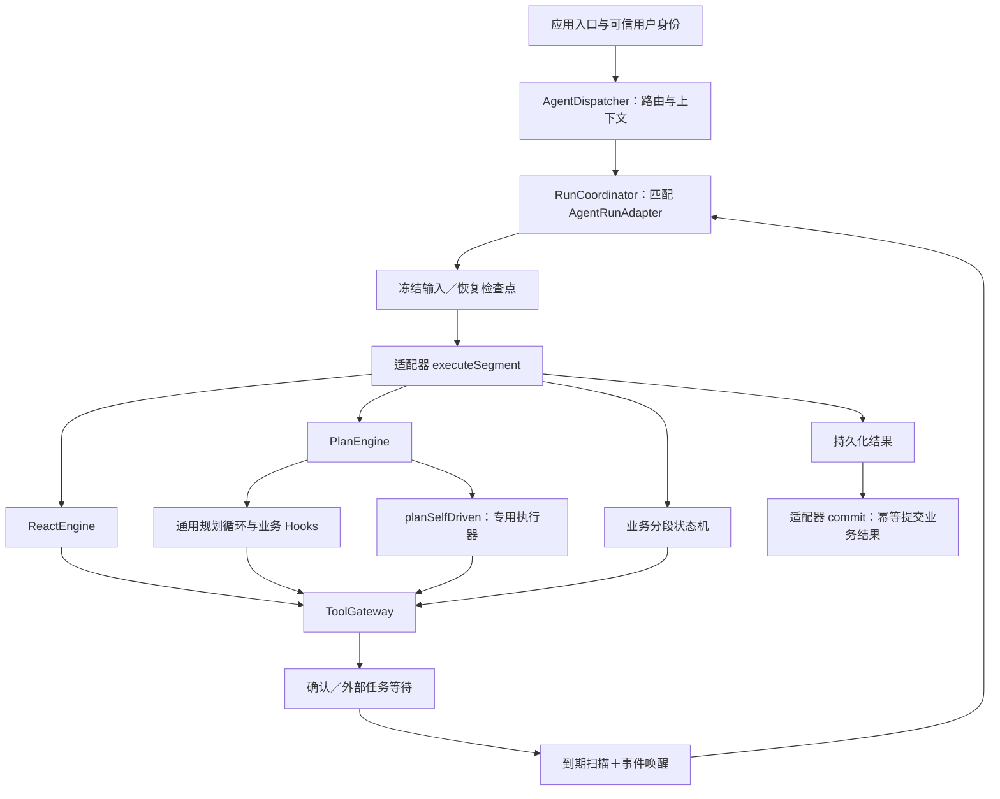

# 底座架构

本文按当前代码解释通用运行能力。源码位于 [platform](../../src/main/java/com/cexpilot/platform)，业务实现位于 [business.cex](../../src/main/java/com/cexpilot/business/cex)。包边界已经建立；独立 Maven 模块、单独制品与独立发布尚未建设。

## 层次与状态归属

| 层次 | 主要对象 | 职责 |
| --- | --- | --- |
| Agent 接入与分发 | ConversationAgent、AgentRegistry、AgentDispatcher | 注册身份与路由、投影上下文、选择执行入口、聚合结果 |
| 执行方式 | ReactEngine、PlanEngine、DagExecutor | 模型决策循环、规划方言、依赖调度、节点结果收集 |
| 持久化运行 | AgentRunAdapter、RunCoordinator、RunScope、RunReconciler | 冻结输入、保存检查点、等待、领取执行权、恢复及结果投递 |
| 方案审批 | PreparedPlan、PreparedToolCall、PreparedPlanService、PreparedPlanExecutor | 冻结方案、统一审批、确定的参数引用、失败停止与结果复用 |
| 工具执行控制 | ToolDefinition、ToolBoundAgent、ToolGateway | 工具契约与绑定、业务权限扩展、确定参数确认、实际提交和查单 |
| 公共支撑 | AgentContextProvider、QueryBudget、LlmCallService、TraceSink、ToolEvidenceWriter | 上下文端口、预算、模型调用与用量、审计和证据写入端口 |

引擎决定一段执行怎样推进，Run 决定这次执行怎样保存、等待和恢复。Run 不等同于用户会话、一次业务任务或其版本。业务自己的规则、查询任务、长期排期和通知状态由业务维护。

## 从分发到执行

Dispatcher 对已匹配运行适配器的 Agent 使用协调器；无适配器时仍存在直接按 engine 分发的路径。生产的声明式 Agent、Query、Monitor 均已有适配器。脱离持久化现场的调用只支持原有同步只读工具，操作和异步工具需要运行入口。

`EngineKind` 当前仍包含 `REACT`、`PLAN` 和过渡值 `BUILTIN`。现有 Query／Monitor 都声明 PLAN；BUILTIN 的枚举及分发分支还存在于代码，不能把“业务已迁移”写成“过渡代码已经删除”。

## Plan 的两种接入

| 接入形态 | 规划循环归属 | 业务提供什么 |
| --- | --- | --- |
| 声明式 Plan | PlanEngine | YAML、Prompt、白名单工具；DeclarativePlanHooks 组装通用 DAG |
| 业务规划方言 | PlanEngine | PlanHooks：输入、校验、修复反馈、完成结果 |
| 自驱动业务 | 专用执行器 | planSelfDriven 返回终态；业务适配器提供持久化恢复现场 |

`planSelfDriven` 是显式扩展端口。引擎不会因此替业务保存任意 Java 状态；输入、检查点、工具调用及输出仍须通过运行契约接入。专用执行器实际调用工具时继续经过 ToolGateway。Query 属于这种接入；其双模式修复和 adaptive 执行不是公共 Plan 循环的一部分。

ReAct 的决策提示词由 react_base_decision＋业务 prompt＋授权工具契约组成，回答由 react_base_answer＋同一业务 prompt 组成，事实通过 user 消息传入。description 仅提供 Router 能力摘要；引擎基础模板不承担 CEX 等领域规则。接入方式见[HTTP 工具与声明式 Agent](HTTP工具与声明式Agent接入.md)。

## 输入、检查点和结果

应用提供 AgentInput，上下文端口按目标 Agent 投影为 PrivateInput。AgentRunAdapter 显式编解码该输入，每个执行片段从 JSON 快照恢复；Consumer、Bean、线程和调用栈不进入数据库。首段 SSE 回调仅在当次进程中临时使用。

RunScope 提供业务检查点和按稳定位置保存的执行日志。RunStep.Completed 表示本段完成，Waiting 通过 RunWaitTarget 引用本运行、本主体的持久化工具调用或审批方案。RunSuspended 是等待控制信号，不能变成工具失败交给模型修复。

公共结果是 ExecutionResult；业务私有结果通过 AgentOutput 及适配器的 captureOutput／restoreOutput 保存。最终结果落库后 commit 可能被重复调用，业务必须依据 runId、来源轮次或唯一键幂等提交。提交失败由协调器重试，不重新规划或执行工具。

模型／工具累计预算随 Run 保存；等待时间不占用新活跃片段的执行时限。未知模型用量、失效租约或协议版本变化按既有保护停止后续执行。只读节点在结果尚未落库的崩溃窗口可能重新查询；外部操作的去重必须由幂等键或查单协议兑现。

## 工具控制与人工确认

工具定义声明 READ／OPERATION、是否确认、输入输出、摘要、资源版本参数、幂等能力及有效期。ToolBoundAgent 声明允许使用哪些工具。ToolAccessPolicy 和 ToolResourceGuard 由应用补充具体权限与资源版本校验，工具分类和确认不能代替业务数据权限。

ToolGateway 在实际调用前检查策略，持久化确定参数、身份、契约和内容指纹。用户批准的是这一份调用，批准后才提交；异步受理后按稳定 jobId 轮询，未知受理状态按 invocationId 恢复。RunReconciler 用到期扫描补偿漏消息，事件只提前唤醒，不接受外部直接伪造成功。

当前工具和 Agent 绑定由 Java／版本管理的 YAML 定义。尚未实现管理后台、在线启停、动态绑定、完整账户／租户授权和跨工具事务。具体协议、API 与表见[工具控制与可恢复运行](工具控制与可恢复运行.md)。

## CEX 适配实例与验证

[QueryRunAdapter](../../src/main/java/com/cexpilot/business/cex/query/QueryRunAdapter.java) 保存专用查询现场，提交查询 TaskVersion。[MonitorRunAdapter](../../src/main/java/com/cexpilot/business/cex/monitor/MonitorRunAdapter.java) 保存对话规划现场，草稿工具仅创建未启用版本；Monitor 自己的周期排期与通知继续归业务。

通用契约的真实 MySQL／强杀测试和业务迁移的 H2 测试是两组证据，范围不同。分别见[底座故障验证](验证记录/2026-11-12-业务运行恢复/README.md)与[CEX 迁移验证](../cex/验证记录/2026-11-12-Agent迁移.md)。已有本地结果不代表全部业务路径均已完成线上验收。

方案审批的契约、权限边界和执行恢复见[方案审批与分阶段执行](方案审批与分阶段执行.md)。它不新增独立业务操作权限目录，权限仍以 Tool 为粒度。

声明式 ReAct／Plan 可通过 tool_approval: prepared_plan 选择方案审批。ReAct 的准备阶段由 PreparedReactExecution 执行，后续新操作形成新方案；声明式 Plan 在 DAG 执行前冻结整份方案。默认 per_call 及业务 Query／Monitor 的专用路径保持原样。
