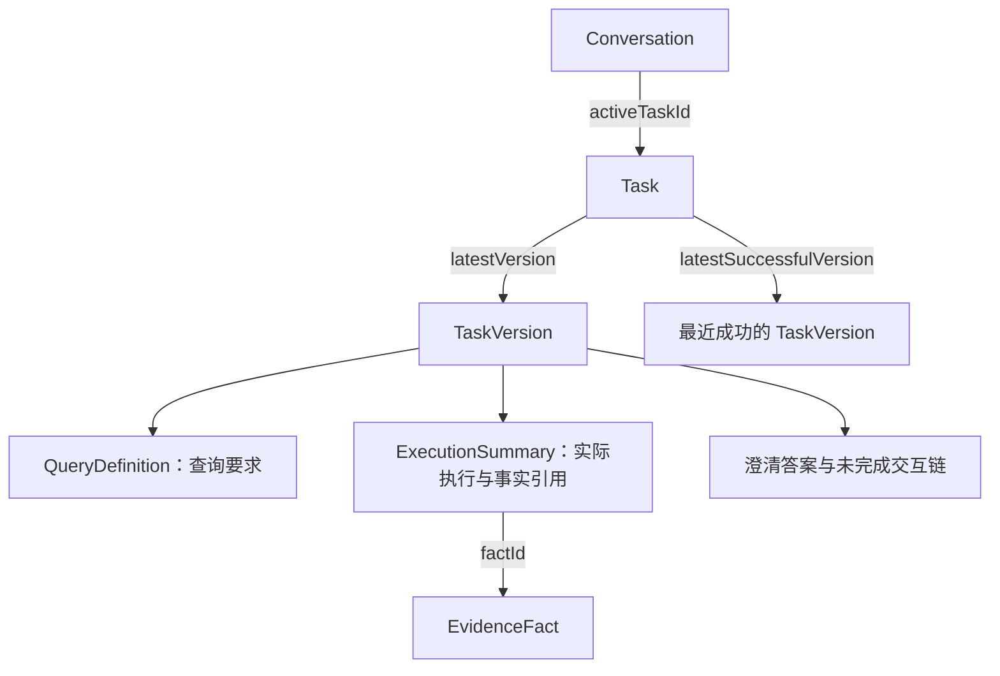

# 上下文管理

本页描述当前查询上下文模型。2026-11-10 统一任务、版本、查询定义与模型引用；不读取旧查询任务数据。

## 1. 领域概念

| 概念 | 含义 | 身份与生命周期 |
| --- | --- | --- |
| Conversation | 连续交互容器，可以讨论多个查询任务 | conversationId |
| Turn | 一次用户输入及其处理，成功、失败、澄清都是轮次 | turnId；queryNo 在会话内递增 |
| Task | 持续讨论、修改和回访的一项查询任务 | 稳定 taskId；持有最新版本入口 |
| TaskVersion | 某次提交后任务的完整可恢复状态 | taskId + version；只追加 |
| QueryDefinition | 完整查询语义及带来源的规范化条件投影 | 属于任务版本，没有独立任务 ID |
| ExecutionSummary | 最近一次有效计划的执行情况与事实焦点 | 记录来源轮次、来源版本及执行状态 |
| TaskVersionCandidate | 一次规划内供模型选择的完整版本 | candidateRef 仅在所属 PlanningContext 有效 |
| PlanningContext | 当前版本、版本候选、事实候选与文本历史的一次性输入投影 | 请求内对象，不另存一份业务状态 |
| EvidenceFact | 实际获取或计算出的历史事实 | 稳定 factId，完整数据由 EvidenceStore 管理 |

实现：[Task](../src/main/java/com/cexpilot/conversation/Task.java)、[TaskVersion](../src/main/java/com/cexpilot/conversation/TaskVersion.java)、[QueryDefinition](../src/main/java/com/cexpilot/conversation/QueryDefinition.java)、[ExecutionSummary](../src/main/java/com/cexpilot/conversation/ExecutionSummary.java)、[PlanningContext](../src/main/java/com/cexpilot/conversation/PlanningContext.java)。



Task 与 TaskVersion 分开：Task A 始终是同一任务，A/v1 与 A/v2 是不同状态。QueryDefinition 不反向包含任务，也不表达任务生命周期。任务版本里的原问题和起始轮次是完整恢复所需的身份摘要，由任务创建/继承流程统一产生。

## 2. ID、版本、临时引用

| 名称 | 作用 |
| --- | --- |
| conversationId | 会话归属与查询范围 |
| visitorId | 访客身份，与 conversationId 不同 |
| turnId / queryNo | 一轮交互的稳定 ID / 会话内顺序 |
| taskId | 稳定任务身份，NEW 时服务端分配 |
| TaskVersion.version | 任务内单调递增的提交版本 |
| TaskVersion.baseVersion | 本次实际继承的旧版本；NEW 为 0 |
| ExecutionSummary.sourceVersion | 执行摘要产生时的任务版本，可能早于当前版本 |
| conversation_state.version | 会话执行占用释放计数，不是任务版本 |
| fencingToken | 执行权代次，防止过期执行者覆盖状态 |
| candidate_ref | 本次规划输入中一个确定任务版本的别名 |
| factId | 持久化事实身份 |
| fact_1、fact_2 | 本次事实候选别名，不能跨请求存作稳定身份 |
| m1 / metric_0 | 当前计划的逻辑组 / 物理节点 ID，不能跨轮标识事实 |

旧 frame 身份、task_ref/state_ref 双引用和 new_frame 协议已移除。候选对象只保存 `candidateRef + taskVersion`，不重复存查询定义、问题和轮次。

## 3. 任务生命周期

| 动作 | 继承基准 | 提交 |
| --- | --- | --- |
| NEW | 无 | 新 taskId，版本 1 |
| CONTINUE | 当前任务最新版本 | 同 taskId，最新版本号 + 1 |
| RESUME | candidate_ref 对应的完整版本 | 同 taskId，在数据库最新版本号之后追加，baseVersion 记所选版本 |

例如 A 已到 v8，用户回到 A/v1 修改交易所，新提交是 A/v9，baseVersion=1；v1 到 v8 均不覆盖。模型必须明确选择一个候选；没有“引用任务但隐式猜测版本”的恢复路径。

每次提交任务状态产生一个版本。普通出域回答、Router 澄清、Monitor 规划及没有查询任务决策的回答只完成轮次，不产生查询任务版本。缺省 task_action 时，有当前任务则 CONTINUE，否则 NEW。

任务状态与轮次状态分开：用户询问“为什么需要期数”，这一轮回答可以成功，任务仍等待补充期数。未完成任务的短回复不能覆盖原问题。

### 澄清与失败

- 原问题、未完成的澄清/失败问答链保存在 TaskVersion.dialogue。
- 结构化填写值保存在 clarificationAnswers，同 key 的新值覆盖旧值，允许纠错。
- 尚无有效计划时 queryDefinition 可以为空；已给出的条件由原问题、补充链和填写值保留，下一轮继续规划。此阶段不把未校验的 Planner 草稿当成有效查询定义。
- 没有新有效计划的失败或澄清，沿用所选版本的查询定义和执行摘要，其来源时间保持原样。
- 有新有效计划时更新 QueryDefinition 和 ExecutionSummary；Answer 失败也保存成功节点的执行元数据。
- Task.latestSuccessfulVersion 只有本轮有效计划执行成功才推进。回访旧版本后失败，不会让这个指针倒退。
- 成功完成任务后清空未完成链及填写值；历史版本仍保留原内容。

## 4. 查询要求与实际执行

QueryDefinition 保存：

- requestTime / timezone：该定义的时间消解基准。
- logicalPlan：经过编译与来源消解的完整查询、计算和历史引用语义。
- targets：同次编译生成的规范化条件投影，包含完整 instrument、时间、interval、count、depth 和字段来源。

logicalPlan 与 targets 由同一个 CompiledPlan 一起生成，作为一个整体保存；targets 不是可独立修改的第二份查询定义。QueryDefinition 中不保存执行状态、事实焦点或实际粒度。

ExecutionSummary 保存：

- sourceVersion / sourceTurnId / status：产生摘要的任务版本、轮次与执行状态。
- focus：节点身份、成功标记、factId 和来源轮次；不复制行情 payload。
- nodeMetadata：以物理节点 ID 为键，保存实际粒度、请求/有效/实际范围、覆盖、样本数量和样本边界等白名单元数据。

只有成功节点的 data 能进入 nodeMetadata。payload 中的样本和任意额外字段不复制。Provider 缺省 effective_range 时，以 requested_range 补齐；自动粒度只存执行摘要，不能变成用户的固定 interval。

### 条件来源

EffectiveTarget.conditionSources 按字段记录来源及继承链。ConditionSource 使用 sourceTaskId / requirementTaskId，不再使用 frame 命名。

- EXPLICIT：用户本轮明确操作。
- INHERITED：从所选任务版本继承。
- DEFAULT：程序默认或自动选择。
- PLANNED：模型提供，但没有足够依据追认为用户固定要求。

Planner 用 condition_updates 声明可选参数 interval/include_unclosed/depth/settle 的 set/reset。set 要求计划提供值，reset 要求省略固定值。程序配对所选版本的目标、消解来源，并在必要时重新编译；不会再调用 LLM 完成这种确定性归一化。

继承时读取所选 TaskVersion，包括其执行摘要中的自动粒度线索；不能从实际使用了 5m 推断用户要求固定 5m。查询条件差异通过 QUERY_DIFF 记录。当前主链不因模型漏填 changes 而拒绝合法查询。

## 5. 一次规划的上下文

[ConversationContextService](../src/main/java/com/cexpilot/conversation/ConversationContextService.java) 的 buildPlanningContext：

1. 读取当前 TaskVersion。
2. 按稳定 taskId 收集当前、近期和最初任务。
3. 为每项任务选取最新、近期、最初、首个有效及最近成功版本，按版本号去重。
4. 分配 candidate_1 等临时引用，一项引用对应一个完整版本。
5. 从这些版本的 ExecutionSummary 收集焦点 factId，优先装入事实候选。
6. 渲染当前任务、查询定义、执行摘要、事实候选、版本索引及近期问答。
7. 返回同一份 PlanningContext，供模型展示与服务端绑定共同使用。

当前预算：近期任务 5 项，另保留最初任务；每任务近期版本 2 个，另保留上述关键版本；事实候选最多 10 条；近期成功问答最多 5 条，答案最多 500 字符。候选之外的回访不猜测，转澄清。

PlanningContext 只保存 currentVersion；activeDefinition() 是从 currentVersion 推导的便捷访问，不维护第二个活动状态。填写澄清表单只生成本请求的待提交投影，不修改持久化历史版本。

提示词分层：

```text
【当前任务】身份、版本、任务状态、原问题
【未完成任务接续】澄清/失败链与填写值
【活动查询状态】查询要求、实际执行摘要及当前事实焦点
【可引用历史事实】本次 fact 别名和身份
【近期任务索引】candidate_ref 对应的任务版本
【近期问答】辅助理解自然语言
```

Router 使用语义投影，不接收事实绑定目录与重复问答；Query Planner 负责任务选择、条件继承和历史事实绑定。Answer 继续使用最近成功问答文本（最多 5 条，答案截断 300 字符）及本轮 FACTS/QUERY_STATUS。

## 6. Planner 协议与历史事实

```json
{"in_domain":true,"task_action":"RESUME","candidate_ref":"candidate_3","plan":{"metrics":[],"calculations":[]},"reply":null}
```

上例只说明版本选择字段；可执行查询必须有非空且合法的实际节点。NEW/CONTINUE 省略 candidate_ref；RESUME 必须命中本次候选，未知引用或不合法组合进入修复/澄清。旧 task_ref/state_ref/new_frame 字段被拒绝，不兼容解析。

任务选择与澄清是两个决策。缺必要条件时 needs_clarification=true、plan=null，并输出非空 clarify 字段列表；task_action=CONTINUE 本身不表示澄清。

引用历史数值必须使用 pinned_result + evidence_ref，由 EvidenceBinder 校验身份、会话、查询形态及字段要求。完整 payload 由 EvidenceStore 读取，不从回答文本反推数字。要求最新数据时使用 latest。

持久化计划中的 pinned 输入以 evidence_fact_id 保存稳定事实身份，不保存当时的 fact 短别名。下一轮渲染时生成本轮 evidence_ref，并移除存储专用字段；没有可定位的事实身份时明确标记不可用。原事实已过期或不在候选中时标记不可用；不能编造别名、使用最新值冒充历史值或删除必要历史输入。派生计算结果不可绑定为原始取数事实。

Query 与 Monitor 共享 Harness，但任务状态分开。条件交接从当前 TaskVersion 的 QueryDefinition 投影出对象与指标，来源标记 source_task_id / source_task_version；不把历史数值、固定日期或样本引用直接变成监控规则。Monitor 的草稿、确认和长期执行状态仍由 Monitor 服务管理。

## 7. 存储与原子提交

| 表 | 唯一职责 |
| --- | --- |
| conversation | 会话身份、访客归属与标题 |
| conversation_state | active_task_id、执行占用、fencing、路由及 Monitor 规划上下文 |
| conversation_task | 稳定任务身份、原问题、起始/最近轮次、latest_version、latest_successful_version |
| conversation_task_version | task_id + version、base_version、source_turn_id、可执行定义标记、完整 version_json |
| conversation_query | 每轮问答、轮次状态、Trace、Agent 响应和 task_id/task_version 关联 |
| conversation_artifact | 历史事实及 payload，见 EvidenceStore |

完整任务状态只保存在 conversation_task_version.version_json。conversation_task 不缓存完整状态，conversation_query 不再保存查询定义或完整任务快照。版本表主键阻止覆盖，source_turn_id 唯一键阻止同轮重复产生版本。

finishTaskTurn 在一个短事务内：

1. 锁定会话状态行并检查 turnId / fencingToken。
2. 解析继承基准，读取任务最新版本号。
3. 构造新的完整版本。
4. INSERT 版本，更新任务版本入口。
5. 写入轮次关联和 active_task_id。
6. 释放执行占用并更新会话活跃时间。

LLM 与行情请求不放在数据库事务内。租约被接管后，旧执行者可以完成自己的轮次记录，但不能更新任务、版本入口、活动指针或新执行者的占用。

## 8. 时间语义

- 本轮 requestTime 在请求开始固定，最新查询以本轮时间取数。
- CONTINUE/RESUME 默认沿用所选任务版本的时区；显式节点时区由时间消解器处理。
- QueryDefinition 的原始时间基准用于理解历史条件和审计，不把本轮“现在”强行回拨。
- 相同滚动窗口延续时随现在移动，不因绝对起止变化记作条件修改。
- 固定日历区间的恢复仍需 Planner 根据所选版本生成正确区间，不可把“昨天”无条件解释为新请求的昨天。

## 9. Trace 与排查

- CONTEXT_RESOLVED：active_task_version、候选事实数和文本历史条数；活动版本含 task_id/version/source_turn_id 及条件摘要。
- CONTEXT_COMMITTED：轮次状态、保存的事实 ID 和 task_updated。
- PLAN_COMPILED：最终查询条件、任务选择、分支 FETCH/REUSE 决策及计算结构。
- QUERY_DIFF：相对所选查询定义的实际条件变化。
- CONDITION_WARNING：来源降级或不可信标注。
- EVIDENCE_REUSE_DECISION / FACT_REUSED：历史事实绑定与复用。
- LLM_CALL：实际完整 prompt、模型响应、耗时和 usage。
- PLANNER_ATTEMPT：每次规划调用及校验结果；Trace 详情保留最终 plan / compiled plan。

优先查看 /api/trace_detail/{traceId}，区分任务基准选择、查询定义、执行数据与回答问题。候选别名只按该次 LLM 输入解读，不能跨 Trace 直接对比其身份。

## 10. 切换旧部署

本次不兼容旧上下文数据。新库使用 [schema.sql](../src/main/resources/db/schema.sql)。旧部署停服、备份后，手工执行 [022_unified_task_model.sql](../src/main/resources/db/migrations/022_unified_task_model.sql)，再部署新代码。该脚本适用于已完成 013～021 迁移的数据库，不在启动时自动运行。

脚本删除旧 conversation_frame 及轮次中的旧完整状态列，清空活动查询任务指针和旧任务动作，创建任务与版本表。不迁移旧任务，旧问答不能恢复成新版任务。问答文本与 Trace 保留供展示和排查；Monitor 规则、调度与投递数据保留。

发布前应核对实际旧库迁移版本，尤其 021 尚未执行时先执行它。不要仅运行 CREATE TABLE IF NOT EXISTS 后直接启动新代码。

## 11. 本地验证

先运行 mvn test-compile，再选择直接相关的单测：

- TaskLifecycleTest：版本追加、原问题、澄清、失败重试、历史回访及最近成功版本。
- ConversationContextServiceTest：分层渲染、候选引用与焦点事实重映射。
- RoutedConversationTest、TaskRepositoryTest：真实 H2 SQL、版本唯一性与事务回滚。
- ConditionProvenanceResolverTest、InheritanceValidatorTest：字段来源与条件比较。
- DagPlannerTest、DagRuntimeTest、TaskPipelineTest、QueryIterationTest：模型选择、执行、跨轮链路与累积计划。
- AnalysisMonitorHandoffTest、MonitorHandoffIntegrationTest：监控条件来源与业务状态隔离。

测试使用本地假模型、假行情和内存数据库。线上回归与收费提示词重放须另有用户明确运行指令，不因本次修改自动执行。
