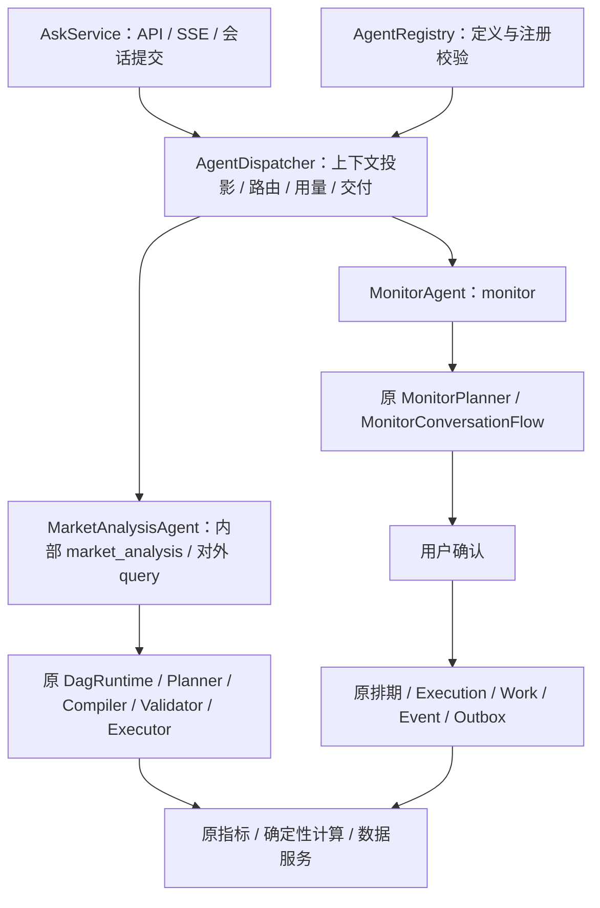

# 共享 Harness 与 Agent 边界：阶段 1

本页记录阶段 1 基线；后续已实现的查询反馈能力见 [查询执行反馈](查询执行反馈.md)。

本期只在现有单体中整理运行边界。Market Analysis 当前适配原 Query DAG；Monitor 适配原监控规划、待确认草稿和确认卡片。没有新增洞察、套利服务、迭代查询、HTTP Tool Adapter 或 YAML Agent 配置。

## 设计与现状证据

此前 AgentDispatcher 同时承担路由、Query 输入处理、Monitor 规划、草稿持久化与确认文案。两条业务链均已存在，问题是公共编排与业务处理交织，并非缺少另一套执行器。

本期以 ConversationAgent 作为一次对话的执行边界。Spring 收集其实现，AgentRegistry 在启动时校验 id / route 唯一性；Router 可用路由来自注册表，Dispatcher 按注册表调用，不增加逐 Agent 的业务执行分支。clarify 是公共澄清结果，不作为第三个 Agent。

## 契约与状态归属

| 契约 | 职责 |
| --- | --- |
| AgentDefinition | 内部 id、兼容 route、路由说明；保留 clarify 路由 |
| ConversationAgent | 版本、执行、是否自行流式交付、路由前的业务状态补充 |
| AgentRunContext | 原始问题、历史、请求时间/时区、Trace、进度与流式回调、EvidenceSession、可信访客、上下文投影和当前 Agent 私有输入 |
| ExecutionResult | 沿用现有结果、轮次状态、事实、业务载荷和用量字段 |
| ExecutionFailure / TurnCounters | 从 DagRuntime 内部移到 runtime，Query / Monitor / Router 共用；保留原异常、任务范围、事实及未知用量语义 |

兼容 route 继续为 query / monitor，内部 market_analysis 不写入旧 active_agent / agentType 字段。新增 AGENT_DISPATCH 事件记录内部 id 和实际 route，便于区分逻辑 Agent 与兼容标识。

AgentContextAssembler 负责从旧会话对象投影 query_task、monitor_context、历史和时间。Router 继续只看摘要，不接收完整监控计划和事实；MonitorPlanner 仍按原行为接收业务候选。投影是条件与业务状态，不是已证实的行情证据。

Query 的 PlannerInput、编译产物回调和 resolvedQuestion 放在 MarketAnalysisAgent.QueryInput 中，只交给 market_analysis；Monitor 不接收该对象。QueryFrame、任务版本和 EvidenceBinder 继续由原 Query 链管理；监控候选、确认版本和长期任务状态继续由 Monitor 服务管理。EvidenceStore 与 TraceSink 复用原实现，不复制存储或增加表。Evidence 的保留期不是实时行情的新鲜度承诺。

AgentRunContext 的 visitor 来自已有服务器入口，不能由模型填写；当前仍是既有访客隔离，不宣称已经支持新的租户授权或远程身份透传。

## 兼容与取舍

- /api/ask、/api/ask/stream、现有 SSE 事件、query / monitor 标识及确认卡片结构继续沿用。
- Query 自行交付流式文本，包含无计划、拒答和澄清终态；其他 Agent 默认由 Harness 交付一次。避免按 LLM 调用数推断是否已流式输出。
- Router 模型调用和修复预算不变；可用路由说明随注册表注入 Prompt，并校验模型不得选择未注册路由。Prompt 指纹包含 Agent 定义和版本，不依赖 Spring 注入顺序。
- 工具许可、Schema、指标口径、计算和执行安全继续由原 ToolRegistry / MetricCatalog / 编译校验链执行。本期不新增另一套授权目录或绕过路径。
- Monitor 的用户确认、固定 DAG、执行租约、恢复、连续命中和通知流程未迁入 Harness；后台不新增 LLM 调用。
- 无数据库迁移。保留 AskService 到 Dispatcher 的旧参数签名作为兼容适配点；公共执行契约不携带完整 Query Planner 对象。
- 新增实现现有运行契约的 Agent 无需修改 Dispatcher 的业务分支；新的私有输入、持久化生命周期、前端能力或 HTTP 协议仍需相应实现。不能把本期描述为任意 Agent 的无代码接入。

删除了 DagRuntime 的两个嵌套类型，Java 调用方改用 runtime.ExecutionFailure / runtime.TurnCounters。部署应执行干净构建，避免旧 target 下的嵌套 class 混入 JAR；这不是 HTTP 或数据库契约变化。

## 验证与遗留

已通过 `mvn clean test-compile`，随后九个直接相关测试类共 98 个用例全部通过。

本地定向验证使用脚本模型、假行情、Mock 服务和独立 H2。覆盖注册冲突、未知路由、扩展 Agent、SSE 单次交付、失败用量、原 Query DAG、多轮状态、监控草稿确认与 Spring 实际装配。未请求线上问答、未调用收费模型、未发送邮件。

阶段 2 再增加执行后观察与有界继续规划；阶段 3 再接 HTTP / YAML；阶段 4 再扩展交接与灰度。当前共享上下文投影仍包含两个既有业务的命名空间，尚不是通用上下文插件协议；不为两个 Agent 先建设此类平台。
