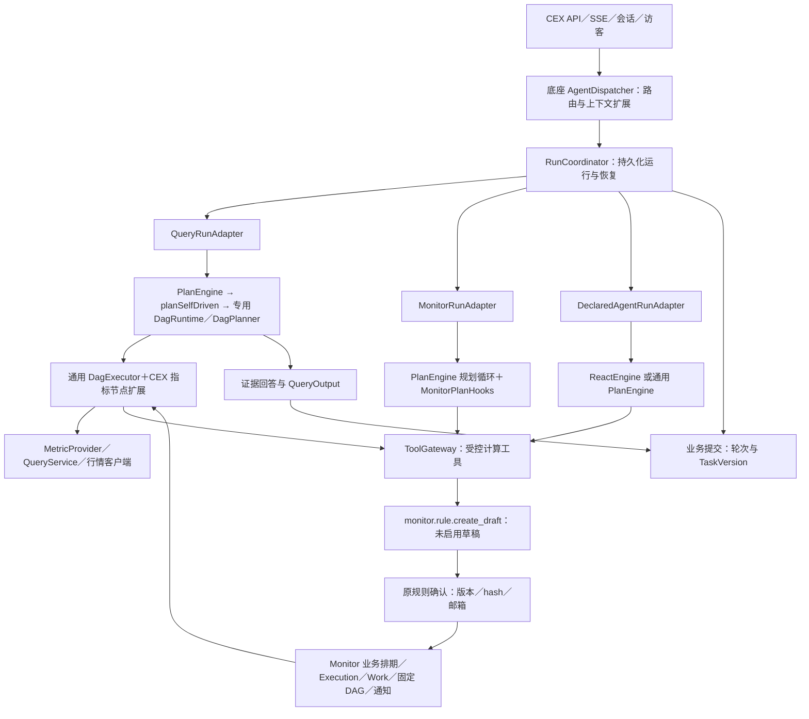

# MarketPilot 当前架构

核对日期：2026-11-13。本文描述当前工作树，线上版本与验收状态以部署及验证记录为准。系统仍是一个 Maven 工程和一个 Spring Boot 主应用，按 package 分为底座、CEX 业务及装配；没有完成底座独立制品或独立发布。

## 整体关系

图中的草稿分支由 Monitor 的工具绑定及业务策略限定。Query 的指标 Provider 是只读业务节点；计算工具走网关。后台 Monitor 使用共享 DAG 和受控计算入口，其排期和执行账本继续由业务管理。

## 包边界

| 区域 | 职责 |
| --- | --- |
| `platform` | Agent 公共契约、上下文端口、React／Plan／DAG 引擎、工具控制、持久化 Run、预算和可观测端口 |
| `business.cex` | Query／Monitor、指标目录及编译、交易所行情、会话任务与事实存储、站点 API／页面、Trace 存储和评测 |
| `bootstrap.configuration` | LLM 与时间等基础设施装配 |

依赖方向是 business → platform，bootstrap 装配二者。底座不能反向依赖 Query、Monitor、TaskVersion 或 CEX 存储类型。具体包结构与端口见[底座包边界](platform/底座隔离与演进.md)。

## 三种 Agent 执行路径

| Agent | 引擎声明 | 运行适配器 | 规划／执行归属 |
| --- | --- | --- | --- |
| 声明式 Agent | REACT 或 PLAN | DeclaredAgentRunAdapter | 底座引擎；YAML、Prompt 与工具白名单提供配置 |
| Monitor | PLAN | MonitorRunAdapter | 通用 Plan 规划循环；Hooks 注入监控协议、校验与草稿组装 |
| Query | PLAN | QueryRunAdapter | 经 PlanEngine 自驱动端口进入专用状态机，保留双模式修复、事实绑定和 adaptive 执行 |

RunCoordinator 管理输入快照、租约、等待、累计预算、最终结果及业务投递；适配器保存私有现场并提交业务状态。Run 的恢复不会重新经过 Router 选择 Agent，也不依赖原 HTTP 请求线程。

`EngineKind.BUILTIN` 过渡枚举和分发分支仍在源码中，当前两类业务 Agent 均使用 PLAN。实际结构与扩展限制见[底座架构](platform/底座架构.md)。

## 业务状态与人工确认

Conversation／Turn 组织交互；Query Task 是可持续讨论的任务，TaskVersion 是追加的状态版本。Run 是一次可恢复执行，工具调用拥有独立 invocationId。Monitor Rule／RuleVersion 是长期规则与定义版本，Execution 是一个周期，Work 是一次执行尝试。这些身份与版本分别建模。

工具的 READ／OPERATION 分类、Agent 绑定、权限扩展和确认要求在统一入口检查。Monitor 建草稿属于 OPERATION，通过程序组装参数保存；该工具本身不要求额外确认。启用监控仍需要用户明确确认规则版本、specHash 与收件邮箱，不能用草稿工具成功代替规则启用。

Query 等待时只保存 WAITING 轮次，不提前创建任务版本。恢复后通过业务提交器幂等提交；若用户已有后续轮次，只补旧历史，不覆盖新活动上下文。Monitor 后台自己的有界恢复与对话 Run 恢复是两套职责，详情见[业务运行适配](cex/Monitor与Query运行迁移.md)。

## 能力与验证边界

CEX 对外能力由 MetricCatalog 中的市场、指标和查询形态绑定决定；工具或 Service 存在不代表已经进入 Query 规划范围。通用 HTTP 工具可以为其他 Agent 提供领域 API，但不会自动变成 CEX 指标或监控条件。

已实现工具控制、参数确认、方案审批共用协议、声明式 Plan 与 ReAct 分阶段接入、异步协议、检查点和推拉恢复；管理后台、动态启停绑定、完整账户／租户授权及跨工具事务尚未建设。现有 Cookie 提供访客归属，邮箱不是身份认证。

底座契约有[历史 MySQL／强杀验证](platform/验证记录/2026-11-12-业务运行恢复/README.md)，两个业务 Agent 有[迁移本地验证](cex/验证记录/2026-11-12-Agent迁移.md)。记录各自的范围和缺口，不能合并解释为整套当前应用已通过生产故障验收。

后续阅读：[底座文档](platform/README.md)、[CEX 文档](cex/README.md)、[全部文档导航](README.md)。

方案审批的当前接入范围与验证见[方案审批与分阶段执行](platform/方案审批与分阶段执行.md)。审批对象是工具调用方案，权限仍然以 Tool 为粒度。
