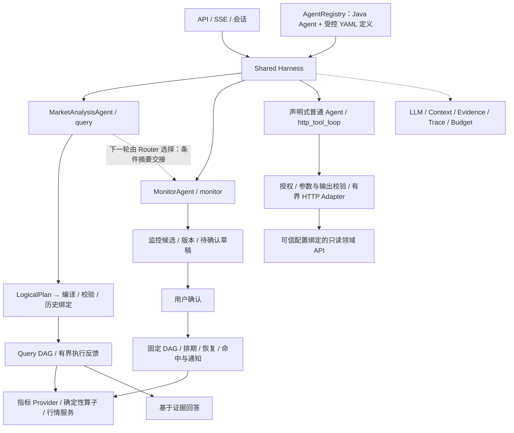

# MarketPilot 当前架构

本文汇总阶段 1～4 已实现的单体架构。代码仍在一个 Java / Spring Boot 服务内，业务服务可以独立部署。共享底座负责受控运行，Agent 负责解决问题，领域模块负责事实、指标语义和业务状态；没有实现洞察、套利服务或自动交易。

## 底座和业务边界

| 模块 | 当前职责 | 业务边界 |
| --- | --- | --- |
| AgentDispatcher / IntentRouter | 路由、运行上下文投影、灰度、交接、用量、交付与公共异常 | 不包含每种 Agent 的业务执行分支 |
| AnalysisMonitorHandoff | 查询转监控时投影条件、记录来源版本与结果 | 不复制历史行情、生成规则或绕过确认 |
| AgentRegistry / ConfiguredAgentFactory | 注册内置实现、加载并校验 YAML、构造已支持的执行策略 | 新生命周期仍需 Java 代码，不能用 YAML 任意覆盖 Query / Monitor |
| MarketAnalysisAgent / DagRuntime | 一次性查询、计算与原有解释；single 或 adaptive | 仍由 MetricCatalog 决定指标与市场范围 |
| MonitorAgent / 监控业务服务 | 候选规划、草稿、确认、版本、排期、恢复和通知 | 后台执行固定规则，不定期重新调用 LLM 生成策略 |
| HttpToolAgent | 普通 Agent 的只读 HTTP 工具循环、参数引用与证据回答 | 不把 HTTP 结果自动当作 Query 指标，也不绕过监控确认 |
| ToolRegistry / HttpAgentTool | 共用工具元数据；Java 或受控 HTTP 执行；鉴权、Schema、时间与失败语义 | 地址、凭证和身份不由模型生成 |
| MetricProvider / QueryService / 领域 API | 取数、单位、口径、完整性、成本或其他明确业务事实 | 不能用模型推测代替真实服务能力 |

## Query 怎样发挥模型能力

模型决定指标、时间表达、计算关系与执行策略。简单查询保留一次 DAG；需要观察后决定下一步时，模型可追加查询或计算、结束或澄清。公共层保留累积计划、复用结果，并检查预算、引用和重复调用；数值仍交给确定性算子。

原始问题与 Router 改写后的独立问题在 Planner 的 user 消息中分开呈现。system 保留静态规则和现有会话上下文，避免原始问题在规则中间截断缓存前缀。动态多轮上下文仍是后续可优化项。

## 扩展路径

1. 新增已支持协议的只读领域 API：Tool YAML + Schema 注册 HTTP 工具，绑定可信服务配置。
2. 新增普通 Agent：Agent YAML 声明业务 Prompt、工具白名单和 http_tool_loop 预算；注册表直接向 Router 暴露。
3. 新增 Query 指标：仍需完整的指标口径、数据查询能力、目录绑定及验证；HTTP 注册本身不能完成这条链路。
4. 新增长期任务或写动作：需要业务生命周期实现；本期不支持由 YAML 开放写操作。

Context 共享可追溯条件摘要，Query Planner 输入和监控候选分开；Evidence 共用会话隔离存储，但 HTTP 事实不进入原指标绑定候选。时间基准从服务器入口固定，不能靠模型或不同服务各自重置“现在”。

HarnessRolloutConfig 按服务端访客稳定分组，分别控制 Query 后续规划、声明式 HTTP Agent 与显式分析转监控交接；Trace 保留本轮开关与策略版本。关闭新增交接回到既有上下文行为，不停止已启用监控。阶段 4 是本次开发计划的最后阶段，线上发布与验收状态仍需另行确认。

当前仍是访客隔离，没有新增完整账户/租户体系。引用、Schema 和成功状态都不能替代业务语义验真；真实模型在长尾问题中的规划效果仍需单独评测。

## 专题文档

- [共享 Harness 与 Agent 边界](共享Harness与Agent边界.md)：阶段 1 的契约与状态归属。
- [查询执行反馈](查询执行反馈.md)：阶段 2 的累积计划、反馈与预算。
- [HTTP 工具与声明式 Agent 接入](HTTP工具与声明式Agent接入.md)：阶段 3 的配置、协议、错误和验证。
- [交接、灰度与验收](交接灰度与验收.md)：阶段 4 的跨轮条件交接、稳定分组、回退与验证范围。
- [Common query 简化](common-query简化.md)：改写与原始输入的分工。
- [主动监控](主动监控.md)：监控业务生命周期。

各阶段文档记录当时实现和验证范围，不代表之后每次部署的在线验收结果。新增标准接入未改动公开问答 API 或数据库表结构。
