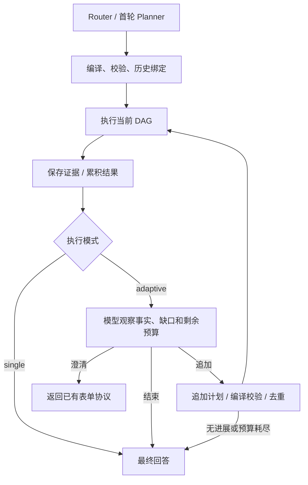

# 查询执行反馈：阶段 2

阶段 2 在既有 Query DAG 上增加有界的执行后规划。当前只有查询、确定性计算和已有解释能力，没有新增洞察、套利判断、HTTP Tool 或 YAML Agent 发布。监控后台继续执行已确认的固定 DAG，不进入此循环。

## 选择与执行

首轮 DagPlanner 可输出可选字段 `execution_mode`：

- `single`：缺省值。规划全部已知查询与计算，执行一次 DAG 后回答，不增加观察调用。
- `adaptive`：后续对象或计算取决于第一批结果时，规划当前必要的一批；执行后选择追加、结束或澄清。

模式由模型根据问题决定，不依赖关键词路由。缺省为 single，也意味着模型漏判 adaptive 时不会自动升级所有查询；这仍需要真实模型评测，本期没有声称任意遗漏都会被自动发现。



后续模型输入包括原问题、完整累积逻辑计划、带来源和错误的观察、固定请求时间/时区、校验反馈和剩余预算。可选动作：

```json
{"action":"continue","reason":"补足差值","plan":{"metrics":[],"calculations":[{"id":"difference","operator":"difference","input":{"left":"{{m1.binance.value}}","right":"{{m1.okx.value}}"}}]}}
```

```json
{"action":"finish","reason":"按已有证据收束","completion":"complete"}
```

```json
{"action":"clarify","reason":"需用户确认","clarify":[{"key":"baseline","label":"比较基准","reason":"missing"}]}
```

`finish.completion` 只是模型的完成度声明，单独记录为 `model_completion_claim`。它不是任务语义验收，也不是行情真值证明；存在执行失败、数据不完整、初始能力缺口或未解决的校验错误时，不能抹掉运行层的 PARTIAL 标记。Answer 仍依据 FACTS，并遵守缺算子结果不能自行补算等现有规则。

## 累积计划与证据

QueryPlanExtension 只接受新增 `metrics + calculations`，不能覆盖或删除旧 id、改写旧条件，也不能直接填写 URL、Tool 或自由表达式。追加计划依然使用现有 MetricPlanCompiler、PlanValidator、FundingAggregationValidator、市场与算子约束。

后续计算引用已有逻辑 id，运行时将累积节点结果作为 seeds；旧取数和旧计算不重复执行、不重复保存事实，不伪装成新的 METRIC_RESULT。新计算的派生事实继续保留旧事实的来源引用。整体仍受原 DAG 节点数与深度上限约束，而不是每轮重置预算。

首轮的历史绑定经过原 EvidenceBinder，后续不新增历史绑定。历史输入始终保留原 factId、观测时间、来源轮次与口径；不能用 latest 替代。新计算中的数值常量仅允许来自用户数字原文或已批准的首轮计算输入，行情数字必须引用节点。它是保守检查，不是完整自然语言常量识别器。

去重依据编译后的指标身份与参数，忽略逻辑组 id；时间表达先按本轮固定基准消解，因此“昨天”换成同一绝对日期仍会被识别。重复计算、空追加、或补充执行后没有新增可用结果会以 NO_PROGRESS 收束。同一失败查询不会被循环重试；依赖客户端已有的传输/分页策略与模型后续规划分别记录，不叠加一套自动模型重试。

每次通过校验的累积计划交给原 compiledPlanSink；QueryFrame / TaskState 保存原任务及全部已接受节点，不只保存最后的补查计划。历史快照和同一对象的新 latest 查询分别识别，既保留旧值，也允许查询现值进行比较。旧目标的条件来源元数据保留，新目标仍为模型规划来源，不伪装成用户明确输入。未执行或失败的目标保留缺口，原会话 fencing 不变，无数据库迁移。

## 预算与停止

配置位于 `query.execution`：

| 配置 | 默认值 | 含义 |
| --- | --- | --- |
| adaptive-enabled | true | 环境变量 QUERY_ADAPTIVE_ENABLED=false 可关闭后续规划 |
| max-continuations | 2 | 最多两次补充执行，最多三次观察决策；非法提案也消耗决策次数 |
| max-model-calls | 8 | Router、首轮 Planner、修复、观察、Answer 累计；为 Answer 保留一个名额 |
| max-tool-calls | 8 | 新准入节点累计预算；旧 seeds 不重复计费，含保守预留的历史绑定/依赖跳过节点 |
| timeout-ms | 180000 | 从 Dispatcher 路由前开始的运行预算；独立 DagRuntime 调用自行创建预算 |
| max-observed-tokens | 48000 | 根据已返回 usage 阻止后续调用；usage 缺失时停止后续模型调用 |

预算作用于 Query 的模型 I/O 和新节点调度；不传入后台 Monitor。模型 I/O 通过有界公共线程池等待剩余时间，节点 Future 的等待也不超过剩余预算。超时后取消等待，阻止后续调度并丢弃迟到流式文本；不能保证撤销上游已接收的请求，也不把它描述为覆盖任意数据库阻塞的 HTTP 接口硬超时。

observed token 预算在收到 usage 后生效，不是服务商侧的单次输出 token 上限，也不保证总费用永不超限。失败调用的 usage 和费用继续按未知记录，不算零费用。

停止原因包括 SINGLE、MODEL_FINISH、CLARIFY、NO_PROGRESS、CONTINUATION_LIMIT、MODEL_BUDGET、TOOL_BUDGET、TOKEN_BUDGET、DEADLINE、ADAPTIVE_DISABLED。仍有模型预算与时间时，让 Answer 根据已有事实说明结果和缺口；无法调用 Answer 时直接返回明确的未完成说明，保留证据。流式回答中途超时则保留已发布前缀并追加终止说明，返回文本与已推送文本一致。

对外轮次继续使用现有 SUCCEEDED / NEEDS_CLARIFICATION / FAILED 契约，SUCCEEDED 表示本轮交付成功，不证明全部业务目标完成。部分执行通过 `agentPayload.execution.execution_status=PARTIAL`、停止原因和事实缺口表达。没有新增线上业务语义验收器。

## Trace 与验证边界

- `LLM_CALL / query_continue` 保存实际完整 prompt、响应、用量及错误。
- `QUERY_ITERATION` 保存原始问题、累积计划、动作、拒绝原因、停止原因及预算；FINAL 含最终调用预算快照。
- `QUERY_NODE_NOT_RUN` 标明因期限未启动的节点，不冒充实际取数。
- 原有 METRIC_RESULT、TOOL_CALL、FACT_REUSED 与 Evidence 的来源协议保留。

本地测试采用脚本模型、模拟行情和内存/H2 存储，验证不同比较结果导向不同后续交易所、补充计算、历史绑定、非法提案、重复查询、部分失败、预算、超时 SSE 和下一轮任务状态。这证明运行契约与确定性执行路径，不能表述为真实模型在所有问法下均能稳定规划。

未执行线上 ask、收费模型重放、交易所探针或真实邮件。后续线上验收仍需明确执行指令，并遵守 AGENTS.md 的备份、逐条对比与转绿复核要求。

### 本次本地验证结果

- `mvn test-compile` 通过。
- 15 个直接相关 Java 测试类共 226 个用例通过，0 失败、0 错误、0 跳过。包括 Query 迭代/预算、原 Planner/Runtime/Executor、Router/AskService、多轮状态、Monitor 草稿、固定 DAG 与检查点兼容。
- `python3 -m unittest discover -s scripts/tests -p test_replay_trace.py -v`：14 个离线用例通过。重放脚本同步可选 execution_mode Schema，保留历史指标/算子能力限制；未发起真实重放。
- 已验证补充计算列表倒序时，派生事实仍按依赖顺序保存，来源链不因模型列表顺序而丢失。
- `git diff --check` 通过。未部署。
